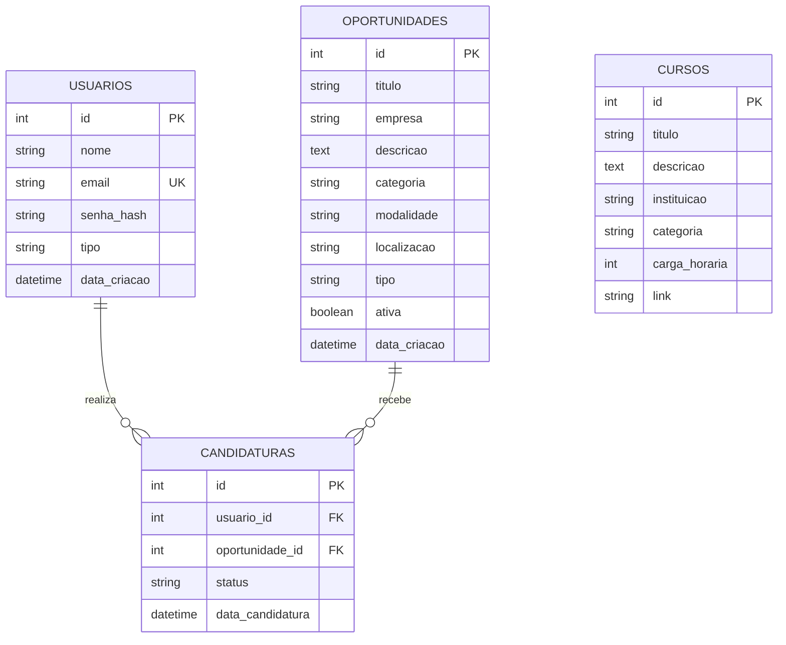

# Relatório técnico: Conecta Jovem

## 1. Visão geral
O Conecta Jovem conecta jovens a vagas de emprego, estágio e jovem aprendiz, a cursos de capacitação e a dicas de carreira, em apoio à ODS 8 (Trabalho Decente e Crescimento Econômico). É uma aplicação web em Flask com banco SQLite acessado por SQLAlchemy. Os dados de exemplo (empresas, vagas, cursos e pessoas) são fictícios.

## 2. Arquitetura
- **Backend:** Flask. `app.py` concentra rotas, validações e inicialização; `models.py` define as tabelas.
- **Banco:** SQLite (`banco.db`), com chaves estrangeiras ativadas (`PRAGMA foreign_keys=ON`) e consultas parametrizadas pelo SQLAlchemy.
- **Frontend:** templates Jinja, CSS e JavaScript puros, tema escuro, layout responsivo.
- **Publicação:** Gunicorn, `Procfile` e `render.yaml`. O caminho do banco vem de `DATABASE_PATH`, para uso com disco persistente.
- **Inicialização:** `create_all()` cria apenas o que falta. Os dados de exemplo entram somente se não houver usuários. Nada é apagado.

## 3. DER



Versão em texto:
```
USUARIOS 1 ----< CANDIDATURAS >---- 1 OPORTUNIDADES        CURSOS (independente)
```
Cardinalidades: um usuário tem várias candidaturas; uma oportunidade recebe várias candidaturas; cada candidatura pertence a um usuário e a uma oportunidade. A restrição `UNIQUE(usuario_id, oportunidade_id)` impede candidaturas duplicadas. A exclusão de usuário ou oportunidade remove as candidaturas associadas (`ON DELETE CASCADE`).

## 4. Dicionário de dados

### usuarios
| Campo | Tipo | Chave | Descrição |
|---|---|---|---|
| id | INTEGER | PK | Identificador |
| nome | VARCHAR(100) | | Nome do usuário |
| email | VARCHAR(120) | Único | E-mail de login |
| senha_hash | VARCHAR(255) | | Hash da senha (Werkzeug) |
| tipo | VARCHAR(10) | | `comum` ou `admin` |
| data_criacao | DATETIME | | Data do cadastro |

### oportunidades
| Campo | Tipo | Chave | Descrição |
|---|---|---|---|
| id | INTEGER | PK | Identificador |
| titulo | VARCHAR(150) | | Título da vaga |
| empresa | VARCHAR(120) | | Empresa (fictícia nos exemplos) |
| descricao | TEXT | | Descrição |
| categoria | VARCHAR(60) | | Área (ex.: Tecnologia) |
| modalidade | VARCHAR(20) | | Presencial, Remoto ou Híbrido |
| localizacao | VARCHAR(100) | | Cidade ou "Remoto" |
| tipo | VARCHAR(20) | | Emprego, Estágio ou Jovem Aprendiz |
| ativa | BOOLEAN | | Se aparece ao público |
| data_criacao | DATETIME | | Data de publicação |

### candidaturas
| Campo | Tipo | Chave | Descrição |
|---|---|---|---|
| id | INTEGER | PK | Identificador |
| usuario_id | INTEGER | FK usuarios.id | Quem se candidatou |
| oportunidade_id | INTEGER | FK oportunidades.id | Vaga escolhida |
| status | VARCHAR(20) | | Enviada, Em análise, Entrevista, Aprovada ou Não selecionada |
| data_candidatura | DATETIME | | Data do envio |

### cursos
| Campo | Tipo | Chave | Descrição |
|---|---|---|---|
| id | INTEGER | PK | Identificador |
| titulo | VARCHAR(150) | | Nome do curso |
| descricao | TEXT | | Descrição |
| instituicao | VARCHAR(120) | | Instituição (fictícia nos exemplos) |
| categoria | VARCHAR(60) | | Área |
| carga_horaria | INTEGER | | Horas |
| link | VARCHAR(300) | | URL para acessar o curso |

## 5. Rotas

### Públicas
| Método | Rota | Função |
|---|---|---|
| GET | `/` | Página inicial |
| GET | `/oportunidades` | Lista com busca (`q`) e filtros (`tipo`, `modalidade`, `categoria`) |
| GET | `/oportunidades/<id>` | Detalhes |
| GET | `/cursos` | Lista de cursos (filtro `categoria`) |
| GET | `/dicas`, `/ods` | Conteúdo educativo |
| GET | `/saude` | Health check |
| GET/POST | `/cadastro`, `/login` | Cadastro e login |

### Autenticadas
| Método | Rota | Função |
|---|---|---|
| POST | `/logout` | Sair |
| GET/POST | `/perfil` | Ver e editar dados, ver candidaturas |
| POST | `/oportunidades/<id>/candidatar` | Candidatar-se |
| POST | `/perfil/candidaturas/<id>/cancelar` | Cancelar a própria candidatura |

### Administrativas (somente `tipo = admin`; resposta 403 para os demais)
| Método | Rota | Função |
|---|---|---|
| GET | `/admin` | Dashboard |
| GET | `/admin/<entidade>` | Listar |
| GET/POST | `/admin/<entidade>/novo` | Criar |
| GET/POST | `/admin/<entidade>/<id>/editar` | Editar |
| POST | `/admin/<entidade>/<id>/excluir` | Excluir |

`<entidade>` é `oportunidades`, `cursos`, `usuarios` ou `candidaturas`.

### API JSON
`GET /api/oportunidades` aceita os mesmos filtros da página e retorna somente vagas ativas:
```json
{"sucesso": true, "total": 10, "oportunidades": [{"id": 1, "titulo": "...", "empresa": "...", "descricao": "...", "categoria": "...", "modalidade": "...", "localizacao": "...", "tipo": "...", "ativa": true, "data_criacao": "..."}]}
```
`GET /api/cursos` retorna `{"sucesso": true, "total": 6, "cursos": [...]}`.
Erros em `/api/*` voltam em JSON: `{"sucesso": false, "erro": "Not Found", "codigo": 404}`.

## 6. Segurança
- Senhas com hash (`generate_password_hash`); a senha nunca é exibida nem armazenada em texto.
- Sessões assinadas, cookie `HttpOnly`, `SameSite=Lax` e `Secure` no Render.
- CSRF: token por sessão exigido em todo POST de formulário.
- Validação sempre no servidor (tamanhos, formatos, opções permitidas, e-mail único, senha com 8+ caracteres, letras e números). O HTML e o JavaScript são apenas apoio.
- SQL parametrizado pelo SQLAlchemy; caracteres `%` e `_` escapados na busca.
- Rotas privadas e administrativas verificadas no backend (decoradores). Redirecionamento após login restrito a caminhos internos.
- O admin não pode excluir a si mesmo, rebaixar a própria conta nem excluir o último administrador.
- Segredos só por variável de ambiente (`SECRET_KEY`). As credenciais de demonstração são fictícias e devem ser trocadas fora de demonstrações.

## 7. Roteiro para a demonstração de 5 minutos
1. Início: proposta e ligação com a ODS 8.
2. Oportunidades: busca por "dados", filtro por Estágio e Remoto.
3. Cadastro de um jovem, login e candidatura. Tentar de novo mostra o bloqueio de duplicidade.
4. Perfil: candidatura com status "Enviada".
5. Login como admin: dashboard e mudança do status da candidatura para "Entrevista" (Candidaturas > Editar).
6. Voltar ao perfil do jovem e mostrar o novo status. Abrir `/api/oportunidades` no navegador.
