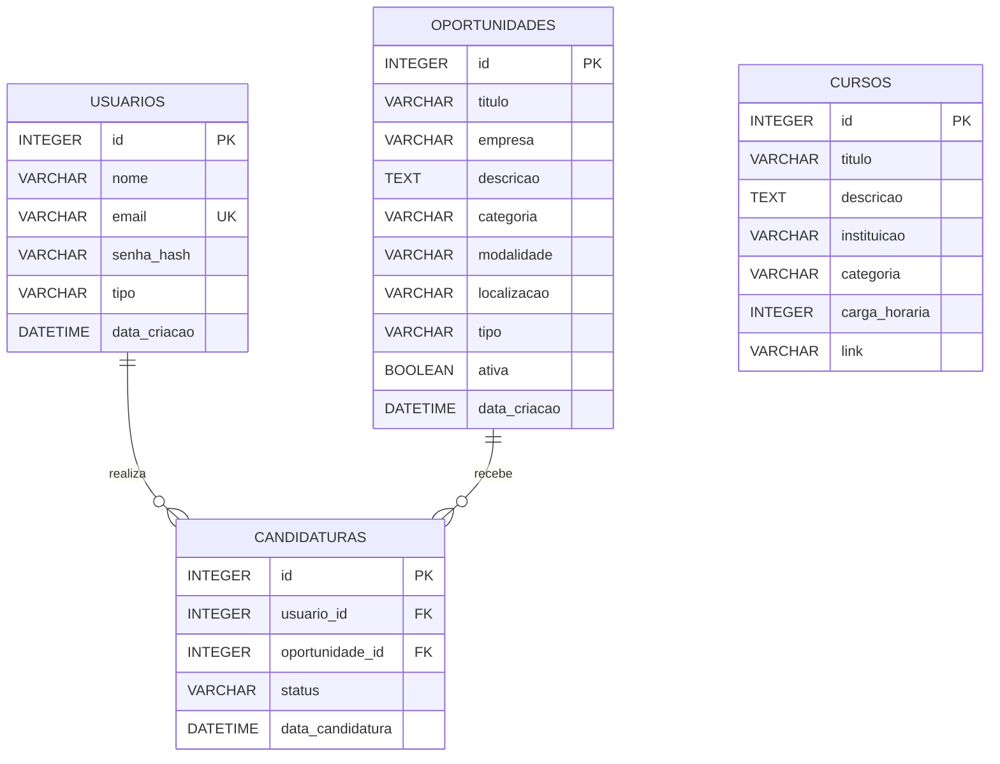

# RELATÓRIO TÉCNICO — CONECTA JOVEM

**Projeto:** Conecta Jovem  
**Área:** Desenvolvimento de Sistemas  
**Tema:** ODS 8 — Trabalho Decente e Crescimento Econômico  
**Desenvolvedor:** Guilherme Gomes de Lima  
**Repositório:** https://github.com/liimazz/conecta-jovem  
**Aplicação publicada:** https://conecta-jovem.onrender.com

---

# 1. APRESENTAÇÃO DO PROJETO

O Conecta Jovem é uma plataforma digital desenvolvida com o objetivo de aproximar jovens de oportunidades de emprego, estágio, jovem aprendiz e capacitação profissional.

A proposta surgiu da necessidade de facilitar o acesso dos jovens ao mercado de trabalho, reunindo em um único ambiente oportunidades profissionais, cursos e orientações para o desenvolvimento da carreira.

O projeto está relacionado à **ODS 8 da Organização das Nações Unidas (ONU) — Trabalho Decente e Crescimento Econômico**, contribuindo para a divulgação de oportunidades e para o incentivo à qualificação profissional.

## 1.1 Objetivo geral

Desenvolver uma aplicação web que facilite o acesso dos jovens a oportunidades profissionais e conteúdos de capacitação, incentivando a inclusão no mercado de trabalho.

## 1.2 Público-alvo

Jovens que estão em busca do primeiro emprego, estágio, oportunidades de jovem aprendiz ou cursos para desenvolver suas habilidades profissionais.

## 1.3 Problema identificado

Muitos jovens encontram dificuldades para localizar oportunidades de trabalho e informações sobre qualificação profissional. A plataforma busca centralizar essas informações e tornar sua consulta mais simples.

---

# 2. TECNOLOGIAS UTILIZADAS

As tecnologias utilizadas no desenvolvimento do projeto foram:

| Tecnologia | Utilização |
|---|---|
| Python | Linguagem principal do back-end |
| Flask | Framework para desenvolvimento web |
| SQLAlchemy | Mapeamento e manipulação dos dados do banco |
| SQLite | Banco de dados local do projeto |
| PostgreSQL | Banco utilizado na configuração atual da hospedagem |
| HTML5 | Estrutura das páginas |
| CSS3 | Estilização e responsividade |
| JavaScript | Interatividade da interface |
| Jinja2 | Renderização dinâmica das páginas |
| Gunicorn | Servidor de aplicação Python |
| Render | Hospedagem da aplicação |
| Git e GitHub | Versionamento e armazenamento do código |

---

# 3. ARQUITETURA DO SISTEMA

O sistema utiliza uma arquitetura baseada em aplicação web, dividida em três partes principais:

### 3.1 Front-end

Responsável pela interface visual e pela interação com o usuário. Foi desenvolvido com HTML, CSS e JavaScript, utilizando templates renderizados pelo Flask.

### 3.2 Back-end

Desenvolvido em Python com Flask. É responsável pelo processamento das requisições, autenticação, gerenciamento de usuários, oportunidades, cursos e candidaturas.

### 3.3 Banco de dados

A aplicação utiliza SQLAlchemy para realizar a comunicação com o banco de dados.

No ambiente local, o projeto possui o arquivo `banco.db`, destinado ao armazenamento dos dados utilizando SQLite.

Na configuração atual da hospedagem, a aplicação foi conectada a um banco PostgreSQL disponibilizado pelo Render por meio da variável de ambiente `DATABASE_URL`.

Essa diferença deve ser considerada na validação do requisito de banco de dados da atividade.

---

# 4. ESTRUTURA DO BANCO DE DADOS

O banco de dados foi organizado em quatro entidades principais:

- **Usuários:** armazena as informações das pessoas cadastradas.
- **Oportunidades:** armazena as vagas de emprego, estágio e jovem aprendiz.
- **Candidaturas:** registra as inscrições dos usuários nas oportunidades.
- **Cursos:** armazena informações sobre cursos de capacitação.

A entidade Candidaturas realiza a ligação entre Usuários e Oportunidades.

## 4.1 Diagrama Entidade-Relacionamento (DER)



## 4.2 Relacionamentos

- Um usuário pode realizar várias candidaturas.
- Uma oportunidade pode receber várias candidaturas.
- Cada candidatura pertence a um usuário e a uma oportunidade.
- O relacionamento entre usuários e oportunidades é realizado pela tabela Candidaturas.
- A tabela Cursos armazena os cursos disponíveis na plataforma.

---

# 5. DICIONÁRIO DE DADOS

O dicionário de dados apresenta os principais campos utilizados nas tabelas do sistema.

## 5.1 Tabela: usuarios

| Campo | Tipo | Descrição |
|---|---|---|
| id | INTEGER | Chave primária e identificador do usuário |
| nome | VARCHAR | Nome completo do usuário |
| email | VARCHAR | E-mail utilizado para identificação e login |
| senha_hash | VARCHAR | Senha armazenada em formato de hash |
| tipo | VARCHAR | Tipo de conta do usuário, como usuário ou administrador |
| data_criacao | DATETIME | Data de criação da conta |

**Chave primária:** id  
**Restrição:** email único.

## 5.2 Tabela: oportunidades

| Campo | Tipo | Descrição |
|---|---|---|
| id | INTEGER | Chave primária da oportunidade |
| titulo | VARCHAR | Nome da vaga ou oportunidade |
| empresa | VARCHAR | Empresa responsável pela oportunidade |
| descricao | TEXT | Descrição e requisitos da oportunidade |
| categoria | VARCHAR | Categoria da oportunidade |
| modalidade | VARCHAR | Modalidade de trabalho |
| localizacao | VARCHAR | Local onde a oportunidade está disponível |
| tipo | VARCHAR | Tipo de oportunidade |
| ativa | BOOLEAN | Indica se a oportunidade está disponível |
| data_criacao | DATETIME | Data de cadastro da oportunidade |

**Chave primária:** id.

## 5.3 Tabela: candidaturas

| Campo | Tipo | Descrição |
|---|---|---|
| id | INTEGER | Chave primária da candidatura |
| usuario_id | INTEGER | Identificador do usuário que realizou a candidatura |
| oportunidade_id | INTEGER | Identificador da oportunidade escolhida |
| status | VARCHAR | Situação atual da candidatura |
| data_candidatura | DATETIME | Data em que a candidatura foi realizada |

**Chave primária:** id.  
**Chaves estrangeiras:** usuario_id e oportunidade_id.  
**Restrição:** combinação de usuario_id e oportunidade_id única, impedindo candidaturas duplicadas para a mesma oportunidade.

## 5.4 Tabela: cursos

| Campo | Tipo | Descrição |
|---|---|---|
| id | INTEGER | Chave primária do curso |
| titulo | VARCHAR | Nome do curso |
| descricao | TEXT | Informações e conteúdo do curso |
| instituicao | VARCHAR | Instituição responsável pelo curso |
| categoria | VARCHAR | Área de conhecimento do curso |
| carga_horaria | INTEGER | Carga horária do curso |
| link | VARCHAR | Endereço para acessar o curso |

**Chave primária:** id.

---

# 6. FUNCIONALIDADES DO SISTEMA

A plataforma foi desenvolvida para disponibilizar diferentes funcionalidades aos usuários.

## 6.1 Cadastro e autenticação

- Cadastro de novos usuários.
- Login por e-mail e senha.
- Diferenciação entre usuários comuns e administradores.
- Acesso às funcionalidades de acordo com o tipo de conta.

## 6.2 Oportunidades profissionais

- Listagem de oportunidades disponíveis.
- Visualização de informações sobre as vagas.
- Consulta de oportunidades por categoria e outros filtros disponíveis.
- Realização de candidaturas.

## 6.3 Gerenciamento de candidaturas

- Registro das candidaturas realizadas.
- Associação entre usuários e oportunidades.
- Consulta do status da candidatura.
- Prevenção de candidaturas duplicadas para a mesma oportunidade.

## 6.4 Cursos e capacitação

- Listagem de cursos.
- Visualização das informações dos cursos.
- Apresentação de instituições, categorias e carga horária.
- Disponibilização de links para acesso aos cursos.

## 6.5 Administração

A plataforma possui uma área administrativa destinada ao gerenciamento das informações do sistema, conforme as permissões da conta de administrador.

---

# 7. OPERAÇÕES CRUD

O CRUD representa as quatro operações básicas de manipulação de dados:

| Operação | Significado | Finalidade |
|---|---|---|
| Create | Criar | Cadastrar novos registros |
| Read | Ler | Consultar registros existentes |
| Update | Atualizar | Modificar registros |
| Delete | Excluir | Remover registros |

No Conecta Jovem, essas operações são aplicadas ao gerenciamento dos dados da plataforma, como usuários, oportunidades, cursos e candidaturas, conforme as rotas e permissões implementadas.

---

# 8. API E RETORNO JSON

O sistema disponibiliza endpoints de API para fornecer informações em formato JSON.

As rotas de API documentadas no projeto são:

| Rota | Finalidade |
|---|---|
| /api/oportunidades | Consultar oportunidades em formato JSON |
| /api/cursos | Consultar cursos em formato JSON |
| /saude | Verificar o funcionamento da aplicação |

O formato JSON permite que os dados sejam consumidos por outras aplicações ou ferramentas.

Exemplo ilustrativo de estrutura de resposta JSON:

```json
{
  "titulo": "Assistente Administrativo",
  "empresa": "Empresa Exemplo",
  "categoria": "Jovem Aprendiz",
  "modalidade": "Presencial"
}
```

---

# 9. SEGURANÇA E VALIDAÇÃO

A segurança é importante para proteger as informações dos usuários e controlar o acesso às funcionalidades da plataforma.

Entre os mecanismos utilizados ou previstos na estrutura do sistema estão:

- Armazenamento de senhas em formato de hash.
- Autenticação por meio de sessões.
- Separação entre contas comuns e administrativas.
- Utilização do SQLAlchemy para interação com o banco de dados.
- Restrições de unicidade para evitar registros duplicados.
- Chaves estrangeiras para manter os relacionamentos entre tabelas.
- Utilização de variáveis de ambiente para configurações sensíveis.

As credenciais de acesso e demais informações secretas não devem ser armazenadas diretamente no repositório público.

---

# 10. PUBLICAÇÃO E HOSPEDAGEM

A aplicação foi publicada na plataforma Render.

**Repositório GitHub:**  
https://github.com/liimazz/conecta-jovem

**Endereço da aplicação:**  
https://conecta-jovem.onrender.com

O processo de publicação envolve:

1. Armazenamento do código-fonte no GitHub.
2. Conexão do repositório ao Render.
3. Instalação das dependências definidas em `requirements.txt`.
4. Inicialização da aplicação utilizando Gunicorn.
5. Configuração das variáveis de ambiente.
6. Conexão com o banco de dados utilizado na hospedagem.

A aplicação também possui uma rota `/saude`, utilizada para verificar se o serviço está respondendo.

---

# 11. DADOS DE DEMONSTRAÇÃO

Foram preparados dados fictícios para demonstrar as funcionalidades da plataforma.

A carga de demonstração foi composta por:

| Tipo de registro | Quantidade |
|---|---:|
| Usuários | 4 |
| Oportunidades | 10 |
| Cursos | 6 |
| Candidaturas | 4 |

Os dados foram inseridos por meio do script `popular_banco.py`, utilizando a configuração de banco de dados disponível no ambiente de execução.

As informações são exclusivamente demonstrativas e não representam empresas ou oportunidades reais.

---

# 12. TESTES E VALIDAÇÃO

Durante o desenvolvimento e a publicação, foram realizadas verificações para avaliar o funcionamento da aplicação.

Entre os testes realizados estão:

- Verificação da inicialização da aplicação.
- Verificação da rota de saúde `/saude`.
- Acesso à página inicial.
- Teste de autenticação da conta administrativa.
- Verificação da conexão com o banco de dados.
- Preparação e inserção dos dados demonstrativos.
- Verificação do funcionamento do serviço publicado.

Outros testes importantes para a apresentação incluem:

- Realizar cadastro de um novo usuário.
- Efetuar login e logout.
- Consultar oportunidades.
- Realizar uma candidatura.
- Tentar realizar uma candidatura duplicada.
- Consultar cursos.
- Testar as operações de criação, edição e exclusão.
- Consultar os endpoints da API.

---

# 13. ROTEIRO DE APRESENTAÇÃO — 5 MINUTOS

## 1º minuto — Apresentação

Apresentar o Conecta Jovem, explicar o problema identificado e relacionar o projeto à ODS 8.

## 2º minuto — Interface e oportunidades

Mostrar a página inicial, a listagem de oportunidades e os filtros disponíveis.

## 3º minuto — Cadastro e candidaturas

Demonstrar o acesso de um usuário, a consulta de uma oportunidade e a realização de uma candidatura.

## 4º minuto — Cursos e administração

Apresentar a área de cursos e demonstrar as funcionalidades administrativas disponíveis.

## 5º minuto — Banco de dados e API

Apresentar o DER, explicar os relacionamentos entre as tabelas e mostrar uma rota da API retornando dados em JSON.

---

# 14. CONCLUSÃO

O desenvolvimento do Conecta Jovem proporcionou a aplicação prática dos conhecimentos adquiridos em desenvolvimento web, programação em Python, utilização do framework Flask, modelagem de banco de dados e publicação de aplicações.

A plataforma demonstra como a tecnologia pode ser utilizada para facilitar o acesso à informação e aproximar jovens de oportunidades profissionais e educacionais.

Além de atender a uma necessidade social, o projeto contribuiu para o desenvolvimento de habilidades técnicas relacionadas à construção de sistemas web, organização de dados, autenticação de usuários e integração entre front-end e back-end.

O Conecta Jovem representa uma aplicação prática da ODS 8, buscando incentivar o trabalho decente, a qualificação profissional e o crescimento econômico.
