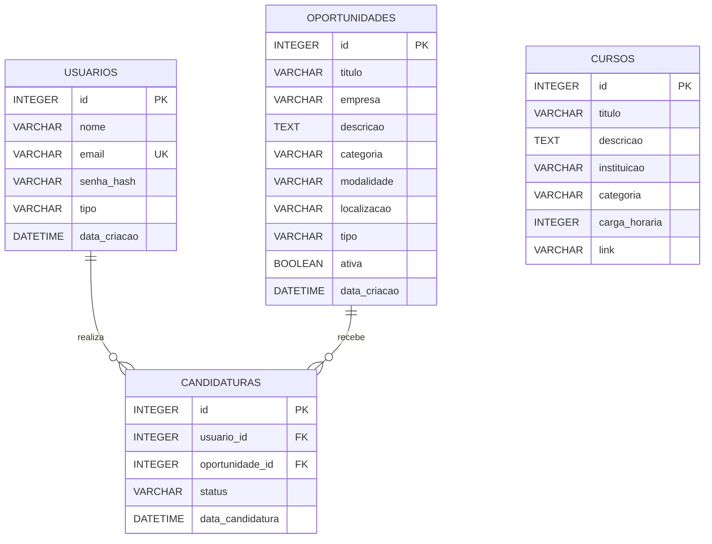

# RELATÓRIO TÉCNICO — CONECTA JOVEM

## 1. IDENTIFICAÇÃO

**Nome do projeto:** Conecta Jovem  
**Integrantes:** Guilherme Gomes de Lima, Vinicius Lemos Lima, Alexandre Filipe Fernandes Rodrigues, José Vitor S. Xavier, Weverton Kauã Ferreira De Lima
**Turma:** 2º Ano B  
**Instituição:** SENAC  
**Curso:** Técnico em Desenvolvimento de Sistemas  
**CEP de referência:** Bairro Câmara Cascudo
**Repositório GitHub:** https://github.com/liimazz/conecta-jovem  
**Aplicação publicada:** https://conecta-jovem.onrender.com

---

## 2. OBJETIVO E ODS

### 2.1 Objetivo do projeto

O Conecta Jovem é uma plataforma digital desenvolvida para aproximar jovens de oportunidades de emprego, estágio, jovem aprendiz e capacitação profissional.

O principal objetivo é facilitar o acesso ao mercado de trabalho, reunindo em um único ambiente oportunidades profissionais, cursos e orientações para o desenvolvimento da carreira.

### 2.2 Problema identificado

Muitos jovens enfrentam dificuldades para encontrar o primeiro emprego, localizar oportunidades de estágio e descobrir cursos que contribuam para sua formação profissional.

A falta de acesso à informação e a dificuldade para encontrar oportunidades em diferentes plataformas podem prejudicar a entrada desses jovens no mercado de trabalho.

### 2.3 Público-alvo

O sistema é destinado principalmente a jovens que estão em busca do primeiro emprego, estágio, jovem aprendiz ou oportunidades de qualificação profissional.

### 2.4 ODS relacionada

O projeto está relacionado à **ODS 8 — Trabalho Decente e Crescimento Econômico**, estabelecida pela Organização das Nações Unidas (ONU).

Essa ODS busca promover o crescimento econômico inclusivo e sustentável, o emprego pleno e produtivo e o trabalho decente para todos.

O Conecta Jovem contribui para esse objetivo ao facilitar a divulgação de oportunidades profissionais e incentivar a qualificação dos jovens.

---

## 3. JUSTIFICATIVA

A escolha do tema surgiu da percepção de que muitos jovens possuem dificuldades para ingressar no mercado de trabalho, principalmente quando estão procurando sua primeira oportunidade profissional.

A plataforma foi pensada como uma maneira de centralizar informações importantes, facilitando a busca por vagas, estágios, oportunidades de jovem aprendiz e cursos de capacitação.

O projeto pode beneficiar a comunidade ao tornar essas informações mais acessíveis, incentivar o desenvolvimento profissional e ajudar os jovens a conhecerem novas possibilidades para o futuro.

Além disso, a proposta permite aplicar conhecimentos de desenvolvimento de sistemas na criação de uma solução tecnológica voltada para um problema social.

---

## 4. MODELAGEM DO BANCO DE DADOS

O banco de dados do Conecta Jovem foi estruturado para armazenar e organizar as informações necessárias ao funcionamento da plataforma.

Foram definidas quatro entidades principais: Usuários, Oportunidades, Candidaturas e Cursos.

### 4.1 Entidades do banco de dados

- **Usuários:** armazena os dados das pessoas cadastradas na plataforma.
- **Oportunidades:** registra as vagas de emprego, estágio e jovem aprendiz.
- **Candidaturas:** registra as inscrições dos usuários nas oportunidades.
- **Cursos:** armazena informações sobre cursos de capacitação profissional.

### 4.2 Diagrama Entidade-Relacionamento (DER)



### 4.3 Relacionamentos

- Um usuário pode realizar várias candidaturas.
- Uma oportunidade pode receber várias candidaturas.
- Cada candidatura está relacionada a um usuário e a uma oportunidade.
- A tabela Candidaturas realiza a ligação entre Usuários e Oportunidades.
- A tabela Cursos armazena os cursos disponíveis na plataforma.

### 4.4 Dicionário de dados

#### Tabela: usuarios

| Campo | Tipo | Descrição |
|---|---|---|
| id | INTEGER | Identificador único do usuário e chave primária |
| nome | VARCHAR | Nome completo do usuário |
| email | VARCHAR | E-mail utilizado para identificação e login |
| senha_hash | VARCHAR | Senha armazenada em formato de hash |
| tipo | VARCHAR | Tipo de conta, como usuário ou administrador |
| data_criacao | DATETIME | Data de criação da conta |

**Restrição:** o campo email deve possuir valor único.

#### Tabela: oportunidades

| Campo | Tipo | Descrição |
|---|---|---|
| id | INTEGER | Identificador único da oportunidade |
| titulo | VARCHAR | Nome da vaga |
| empresa | VARCHAR | Empresa responsável pela oportunidade |
| descricao | TEXT | Descrição e requisitos da vaga |
| categoria | VARCHAR | Categoria da oportunidade |
| modalidade | VARCHAR | Modalidade de trabalho |
| localizacao | VARCHAR | Local onde a oportunidade está disponível |
| tipo | VARCHAR | Tipo da oportunidade |
| ativa | BOOLEAN | Indica se a oportunidade está disponível |
| data_criacao | DATETIME | Data de cadastro da oportunidade |

#### Tabela: candidaturas

| Campo | Tipo | Descrição |
|---|---|---|
| id | INTEGER | Identificador único da candidatura |
| usuario_id | INTEGER | Identificador do usuário relacionado |
| oportunidade_id | INTEGER | Identificador da oportunidade relacionada |
| status | VARCHAR | Situação atual da candidatura |
| data_candidatura | DATETIME | Data em que a candidatura foi realizada |

**Chaves estrangeiras:** usuario_id e oportunidade_id.

**Restrição:** a combinação de usuário e oportunidade é única, evitando que o mesmo usuário se candidate mais de uma vez à mesma vaga.

#### Tabela: cursos

| Campo | Tipo | Descrição |
|---|---|---|
| id | INTEGER | Identificador único do curso |
| titulo | VARCHAR | Nome do curso |
| descricao | TEXT | Informações sobre o conteúdo |
| instituicao | VARCHAR | Instituição responsável |
| categoria | VARCHAR | Área de conhecimento |
| carga_horaria | INTEGER | Carga horária do curso |
| link | VARCHAR | Endereço para acessar o curso |

### 4.5 Banco de dados utilizado

O projeto utiliza SQLAlchemy para realizar a comunicação entre a aplicação e o banco de dados.

No ambiente local, o projeto possui o arquivo `banco.db`, destinado ao armazenamento das informações utilizando SQLite.

Na configuração atual da hospedagem, foi utilizado PostgreSQL no Render, por meio da variável de ambiente `DATABASE_URL`.

Essa diferença entre o ambiente local e o ambiente publicado deve ser considerada na validação do requisito de SQLite da atividade.

---

## 5. FUNCIONALIDADES

O Conecta Jovem possui funcionalidades voltadas para facilitar o acesso dos jovens a oportunidades profissionais e conteúdos educacionais.

### 5.1 Cadastro e login

- Cadastro de novos usuários.
- Login utilizando e-mail e senha.
- Autenticação de usuários.
- Diferenciação entre usuários comuns e administradores.

### 5.2 Oportunidades profissionais

- Listagem de oportunidades disponíveis.
- Visualização dos detalhes das vagas.
- Consulta de informações sobre empresas.
- Busca e filtros de oportunidades disponíveis.
- Acesso às oportunidades de emprego, estágio e jovem aprendiz.

### 5.3 Candidaturas

- Realização de candidaturas nas oportunidades.
- Registro das inscrições dos usuários.
- Associação entre usuários e oportunidades.
- Consulta do andamento das candidaturas.
- Prevenção de candidaturas duplicadas.

### 5.4 Cursos

- Listagem de cursos de capacitação.
- Visualização das descrições.
- Consulta de instituições e categorias.
- Exibição da carga horária.
- Disponibilização de links de acesso.

### 5.5 Administração

- Acesso administrativo.
- Gerenciamento das informações da plataforma.
- Administração de oportunidades e demais registros conforme as permissões implementadas.

### 5.6 API

O sistema disponibiliza rotas que retornam informações em formato JSON.

Rotas documentadas:

- `/api/oportunidades` — consulta de oportunidades.
- `/api/cursos` — consulta de cursos.
- `/saude` — verificação do funcionamento da aplicação.

Exemplo ilustrativo de retorno JSON:

```json
{
  "titulo": "Assistente Administrativo",
  "empresa": "Empresa Exemplo",
  "categoria": "Jovem Aprendiz",
  "modalidade": "Presencial"
}
```

### 5.7 Operações CRUD

O sistema utiliza operações CRUD para a manipulação de registros:

- **Create:** criação de registros.
- **Read:** consulta de informações.
- **Update:** atualização de registros.
- **Delete:** exclusão de registros.

Essas operações fazem parte do gerenciamento dos dados da plataforma, respeitando as permissões e funcionalidades implementadas.

---

## 6. TECNOLOGIAS UTILIZADAS

| Tecnologia | Aplicação no projeto |
|---|---|
| Python | Linguagem utilizada no desenvolvimento do sistema |
| Flask | Framework responsável pelo back-end e pelas rotas |
| SQLite | Banco de dados utilizado no ambiente local |
| PostgreSQL | Banco utilizado na configuração atual da hospedagem |
| SQLAlchemy | Integração entre a aplicação e o banco de dados |
| HTML5 | Estrutura das páginas |
| CSS3 | Estilização e organização visual |
| JavaScript | Interatividade da interface |
| Jinja2 | Renderização dinâmica das páginas |
| Gunicorn | Servidor utilizado para executar a aplicação |
| Render | Plataforma de hospedagem |
| Git | Controle de versões |
| GitHub | Armazenamento e compartilhamento do código-fonte |

---

## 7. RELAÇÃO COM OUTRA UC

O desenvolvimento do Conecta Jovem possui relação com diferentes unidades curriculares do curso Técnico em Desenvolvimento de Sistemas.

### 7.1 Banco de Dados

Os conhecimentos de banco de dados foram utilizados na criação das tabelas, definição dos campos, identificação das chaves primárias e estrangeiras e construção dos relacionamentos entre as entidades.

### 7.2 Desenvolvimento Back-end

Os conhecimentos de programação em Python e utilização do Flask foram aplicados na criação das rotas, processamento das informações, autenticação e comunicação com o banco de dados.

### 7.3 Desenvolvimento Front-end

Os conhecimentos de HTML, CSS e JavaScript foram utilizados para construir as páginas, organizar os conteúdos e desenvolver a interação entre o usuário e a plataforma.

### 7.4 Experiência do Usuário (UX)

Os conceitos de experiência do usuário foram considerados na organização das informações, navegação e apresentação das funcionalidades, buscando tornar a plataforma simples e acessível.

---

## 8. DIFICULDADES ENCONTRADAS

Durante o desenvolvimento do projeto, alguns desafios foram encontrados.

Um dos principais desafios foi organizar a estrutura do banco de dados e definir corretamente os relacionamentos entre usuários, oportunidades e candidaturas.

Também foi necessário integrar o back-end desenvolvido em Python com as páginas do front-end, garantindo que as informações fossem apresentadas corretamente.

Outro desafio foi melhorar a interface visual, organizar as páginas e tornar a navegação mais intuitiva.

A publicação do sistema no Render também exigiu atenção à configuração das dependências, variáveis de ambiente, servidor de execução e conexão com o banco de dados.

Essas dificuldades contribuíram para ampliar o entendimento sobre o desenvolvimento de aplicações web completas e a integração entre diferentes tecnologias.

---

## 9. CONCLUSÃO

O desenvolvimento do Conecta Jovem permitiu colocar em prática os conhecimentos adquiridos durante o curso Técnico em Desenvolvimento de Sistemas.

Ao longo do projeto, foram trabalhados conceitos de programação, desenvolvimento web, modelagem de banco de dados, integração entre front-end e back-end e publicação de aplicações.

Além do aprendizado técnico, o projeto possibilitou refletir sobre um problema presente na sociedade: a dificuldade que muitos jovens enfrentam para encontrar oportunidades profissionais e desenvolver suas habilidades.

A proposta do Conecta Jovem é utilizar a tecnologia como ferramenta de apoio à inclusão profissional, contribuindo para a divulgação de oportunidades e para a qualificação dos jovens.

Conclui-se que o projeto foi uma experiência importante para o desenvolvimento de habilidades técnicas e para a compreensão de como a tecnologia pode ser aplicada na criação de soluções para necessidades reais da comunidade.
